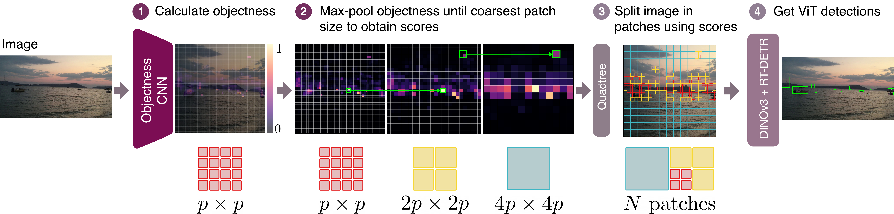

# ⛵️ Patch Where Objects Are 🌊


**Research code** to reproduce the results of the paper *Patch Where Objects Are: Objectness-Guided Mixed-Resolution ViTs for
Small-Object Detection in Maritime Scenes* (WACV 2027).

## 📫 Updates

- **2026/11/02**: Code released
- **2026/10/15**: Paper accepted at WACV 2027

## 🧮 Method



On a fine, uniform grid, a lightweight objectness scorer assigns high values to regions which are likely to contain objects.
Then, fine patches are used in high-objectness regions and more coarse patches elsewhere.
The patches are assigned within a fixed token budget, making the compute controllable.
A DINOv3 ViT-B/16 backbone and RT-DETR head process the resulting mixed-resolution tokens to get detections.
At low token budgets, this improves the speed-accuracy trade-off compared to uniform patches, especially for ✨ small objects ✨.

## 👩‍💻 Getting started

### Installation

You need Python ≥ 3.11 and a CUDA GPU for training. The paper results were
produced with Python 3.11, torch 2.6.0, torchvision 0.21.0 (CUDA 12.4 builds)
and transformers 5.20.2. `requirements.txt` specifies the exact environment.

**1. Clone the repo 👾**

```bash
git clone https://github.com/SEA-AI/patch-where-objects-are.git
cd patch-where-objects-are
```

**2. Create an environment 💻**

Either you can use uv or conda, whatever you prefer.

⚡ **uv** (fast)

```bash
uv venv --python 3.11                 # creates .venv/ in the repo
source .venv/bin/activate
uv pip install -r requirements.txt    # optional: exact versions of the paper environment
uv pip install -e ".[dev]"            # the package itself (editable) + pytest/ruff
```

<details>
<summary>🐍 <b>conda</b></summary>

```bash
conda create -n pwoa python=3.11      # new env called "pwoa"
conda activate pwoa
pip install -r requirements.txt       # optional: exact versions of the paper environment
pip install -e ".[dev]"               # the package itself (editable) + pytest/ruff
```

</details>

**3. Tell the configs where your files should go** 📁

All configs and scripts find data and outputs only through these
two environment variables, so no paths need to be edited:

```bash
export DATA_ROOT=/path/to/data        # datasets + DINOv3 weights (layout below)
export OUTPUT_ROOT=/path/to/outputs   # everything that gets written: checkpoints, score caches
```

Add them to your `~/.bashrc` (or the env's activate script) so you don't have
to set them in every shell.

**4. Check that it works** ✅

```bash
pytest
```

**5. Optional: log to Weights & Biases** 📈

W&B logging is off by default. Without it, `train.py` still writes all
metrics to `metrics.json` in the run directory and `train_objectness.py`
prints them per epoch. To use W&B, install the extra and enable it per run:

```bash
pip install -e ".[wandb]"
python scripts/train.py --config <config> --train.wandb true   # project: --train.wandb_project <name>
python scripts/train_objectness.py <args> --wandb              # project: --wandb-project <name>
```

The default project is `pwoa`.

### Data & weights

See [data/README.md](data/README.md) for the setup.

## 📊 Results

Our key finding is that **objectness-guided mixed-resolution ViTs outperform uniform, entropy-guided, and feature-distortion-guided token selection at low backbone token budgets when evaluated in-domain.**

The table below highlights test results on SeaClips (AP@0.5) and LaRS (class-agnostic F1-score). Token budgets cap the number of tokens processed by the ViT backbone.<sup>*</sup> See the paper for the full results.

| Method | SeaClips (576 tokens) | SeaClips (784 tokens) | LaRS (576 tokens) | LaRS (784 tokens) |
|:--|--:|--:|--:|--:|
| Uniform | 3.13 | 3.25 | 22.68 | 25.89 |
| Entropy | 4.04 | 5.56 | - | - |
| Feature distortion | 10.91 | 11.71 | 21.81 | 27.33 |
| **Objectness (ours)** | **12.05** | **12.26** | **28.12** | **30.57** |

<sub>* The adaptive quadtree starts from 13 × 13 = 169 coarse tokens at 832 px and adds 3 per split, so a budget of 576 gives 574 tokens, while 256 and 784 are reached exactly.</sub>

## 🚀 Training

All experiments are launched from the `scripts/` folder. Configuration files define the experiment setup, and optional `--<section>.<field> <value>` arguments override individual settings.

### 1. Train a uniform baseline

Train a uniform baseline using 16 × 16 pixel patches for 35 epochs:

```bash
python scripts/train.py \
    --config configs/uniform/lars_832.yaml \
    --train.seed 42 \
    --train.gpu 0
```

### 2. Train an objectness scorer

The objectness scorer is trained on per-cell caches of the ground-truth objectness maps.
First, build the caches for the training and validation splits, then you can train a scorer (60 epochs):

```bash
for split in train val; do
  python scripts/compute_cell_scores.py \
      --json $DATA_ROOT/lars/lars_${split}_coco.json \
      --out $OUTPUT_ROOT/cell_scores/cache_lars_${split}_832.npz
done

python scripts/train_objectness.py \
    --train-cache $OUTPUT_ROOT/cell_scores/cache_lars_train_832.npz \
    --val-cache $OUTPUT_ROOT/cell_scores/cache_lars_val_832.npz \
    --data-root $DATA_ROOT/lars/lars_v1.0.0_images \
    --out-dir $OUTPUT_ROOT/objectness_scorer_lars/s0 \
    --seed 0 \
    --device cuda:0
```

The adaptive config reads the scorer from `$OUTPUT_ROOT/objectness_scorer_<dataset>/s<seed>/scorer_best.pth`.

### 3. Train an adaptive model

Adaptive models are fine-tuned from a uniform checkpoint for one epoch.
`--train.init_from` is required when starting a new adaptive run.

**Objectness-guided** (also takes `--backbone.scorer_checkpoint`, defaults to `$OUTPUT_ROOT/objectness_scorer_<dataset>/s<seed>/scorer_best.pth`):

```bash
python scripts/train.py \
    --config configs/adaptive/lars.yaml \
    --backbone.patch_selector objectness \
    --backbone.scorer_checkpoint $OUTPUT_ROOT/objectness_scorer_lars/s0/scorer_best.pth \
    --backbone.token_budget 576 \
    --train.init_from $OUTPUT_ROOT/uniform_lars_832/s42/<checkpoint>.pth \
    --train.seed 0 \
    --train.gpu 0
```

**Training-free criteria** (`entropy`, `feature_distortion`, `random`: no scorer checkpoint needed):

```bash
python scripts/train.py \
    --config configs/adaptive/lars.yaml \
    --backbone.patch_selector entropy \
    --backbone.token_budget 576 \
    --train.init_from $OUTPUT_ROOT/uniform_lars_832/s42/<checkpoint>.pth \
    --train.seed 0 \
    --train.gpu 0
```

> [!NOTE]
> With a token budget of 256, also set `--head.num_queries 100`. The default of 300 decoder queries is more than the number of tokens.

## 🧪 Evaluation

Training evaluates `data.val_json` after each epoch and records those results
under `val` in `metrics.json`. It keeps two best checkpoints:

| Checkpoint | Selected on |
|---|---|
| `checkpoint_epoch<N>_best.pth` | AP@0.5 |
| `checkpoint_epoch<N>_best_small.pth` | mean(AP_allsmall@0.3, AP_allsmall@0.5) |

To perform the final test set evaluation, add `--eval_only` to evaluate the best checkpoint of a run on its validation split. `--eval_checkpoint` chooses which one: `best` (default) or `best_small`. Use `--train.load_for_eval <checkpoint>` to evaluate a specific checkpoint instead.

```bash
python scripts/train.py \
    --config configs/adaptive/lars.yaml \
    --backbone.patch_selector objectness \
    --backbone.token_budget 576 \
    --train.seed 0 \
    --train.gpu 0 \
    --eval_only
```

### Held-out test sets

Repeat the training command of the run with `--eval_only` and point `--data.val_json` to the test annotations:

| Trained on | Test set | Additional arguments |
|---|---|---|
| SeaClips | SeaClips test | `--data.val_json $DATA_ROOT/seaclips/sea-cocovid-test.json` |
| MODD2 | MODS | `--data.val_json $DATA_ROOT/mods/mods_obstacle_test_coco.json --data.image_root $DATA_ROOT/mods` |

The results are written to `<checkpoint stem>_eval_<json stem>.json` next to the checkpoint.

`scripts/export_lars_test.py` writes the predictions in the format of the [MaCVi USV challenge toolkit](https://github.com/JonNatanael/macvi-usv-odce-toolkit-2024) for submission to the test server. It takes the same config and overrides as the training run:

```bash
python scripts/export_lars_test.py \
    --config configs/adaptive/lars.yaml \
    --backbone.patch_selector objectness \
    --backbone.token_budget 576 \
    --train.seed 0 \
    --min-score 0.30 \
    --gpu 0
```

By default it uses the best checkpoint of the run (`--checkpoint` selects another one) and writes `lars_test_<checkpoint stem>_min0.30.json` next to it.

### Outputs

Each run saves its checkpoints, resolved configuration (`config.yaml`), and metrics (`metrics.json`) under:

```text
$OUTPUT_ROOT/<run_name>/s<seed>/
```

For example:

```text
$OUTPUT_ROOT/adaptive_objectness_lars_ft1_n576/s0/
```

## 🔍 Demo

[`notebooks/demo.ipynb`](notebooks/demo.ipynb) (`pip install -e ".[demo]"`) loads a trained objectness-guided model from its run directory and shows the objectness map, the selected mixed-resolution patches and the detections for a data sample.

## 🗺️ Layout

| Folder | Contents |
|---|---|
| `src/patch_where_objects_are/` | Main: patch selectors, mixed-resolution patch embedding, detector, training and evaluation |
| `configs/` | One YAML per run setting: `uniform/` baselines, `adaptive/` models |
| `scripts/` | Command-line programs that produce something the pipeline uses: `train.py` (detector), `train_objectness.py`, `compute_cell_scores.py`, `export_lars_test.py` |
| `data/` | Dataset conversion to COCO JSONs: `convert_lars.py`, `convert_modd2.py`, `convert_mods.py` |
| `notebooks/` | `demo.ipynb`: model loading, objectness map, patch layout and detections |

## 🙏 Acknowledgements

This code builds on the following projects.

- [DINOv3](https://github.com/facebookresearch/dinov3): the backbone, implemented with
the [transformers](https://github.com/huggingface/transformers).
- [RT-DETR](https://github.com/lyuwenyu/RT-DETR): the detection
head, deformable attention, matcher and
criterion, which in turn build on
[Deformable DETR](https://github.com/fundamentalvision/Deformable-DETR) and
[DETR](https://github.com/facebookresearch/detr).
- [APT](https://github.com/rccchoudhury/apt): the entropy criterion.
- [Quadformer](https://github.com/TomerRonen34/mixed-resolution-vit): the
feature distortion criterion.
- [pycocotools](https://github.com/cocodataset/cocoapi): the adapted COCO
evaluation in `evaluators/adapted_pycocotools/`.

We thank the authors of LaRS, MODD2 and MODS for the datasets.

## 💬 Citation

```bibtex
@inproceedings{denk2027patch,
  title     = {Patch Where Objects Are: Objectness-Guided Mixed-Resolution ViTs for Small-Object Detection in Maritime Scenes},
  author    = {Denk, Franziska and Serrano, Kevin and Sablatnig, Robert},
  booktitle = {IEEE/CVF Winter Conference on Applications of Computer Vision (WACV)},
  year      = {2027}
}
```

## License

The code is released under the [Apache License 2.0](LICENSE), except
`evaluators/adapted_pycocotools/cocoeval.py` (Simplified BSD License, from
pycocotools). Third-party notices are in [NOTICE](NOTICE).

---

*This work is done as a PhD research project, supported by the Austrian Research Promotion Agency (FFG) as “SEA-OD” (# 921850).*
